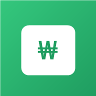

# mini weple 💸

**위플 가계부 앱을 참고해 만든, 서버 없이 브라우저만으로 동작하는 달력형 가계부 웹앱(PWA)입니다.**

HTML / CSS / JavaScript만으로 만들었습니다. 아이폰과 안드로이드에서 홈 화면에 설치하면 앱처럼 쓸 수 있고, 한 번 열어 두면 인터넷 없이도 열립니다.

🌐 **바로 사용하기: https://ohjunkyun.github.io/mini-weple/**



---

## 주요 기능

### 📅 달력 가계부
- 위에서부터 **월 이동 → 수입 / 지출 / 합계 → 달력 → 선택한 날의 내역** 순서로 보여줍니다.
- 달력의 날짜 칸마다 그날 수입(파란색)과 지출(빨간색)을 표시합니다.
- 오늘 날짜는 주황색 동그라미, 일요일은 빨간색, 토요일은 파란색으로 표시합니다.

### ✏️ 내역 입력 / 수정 / 삭제
- **`+` 버튼**으로 원하는 날짜에 지출이나 수입을 입력합니다. 입력 항목은 날짜, 금액, 분류, 결제수단, 내용입니다.
- 금액에는 천 단위 쉼표가 자동으로 붙습니다.
- 내역을 **왼쪽으로 밀면** `수정`과 `삭제` 버튼이 나옵니다.
- 분류
  - 지출: 식비, 카페, 교통, 주거, 쇼핑, 문화, 의료, 저축, 기타
  - 수입: 급여, 용돈, 부수입, 기타수입

### 🐷 저축
- 지출 분류에 **저축**이 있습니다.
- 저축을 고르면 **"저축을 지출에 포함하지 않기"** 체크 칸이 나옵니다. 체크한 저축은 지출 합계에서 빠집니다.
- **저축 목표**(만원 단위)를 정하면, 지금까지 모은 저축이 목표의 몇 %인지 막대와 함께 보여줍니다.

### 🔁 남은 돈 이월
- 한 달 수입이 지출보다 많으면, 남은 돈을 **다음 달 1일에 "전월 이월" 수입으로 자동으로** 넘깁니다.
- 지난달 내역을 고치면 이월 금액도 자동으로 다시 계산됩니다.

### ⚠️ 충동구매 속도 경고
- 지출을 입력할 때 **"충동구매였어요 💸"** 를 체크할 수 있습니다.
- 이번 달 **급여 + 용돈**의 일정 비율(기본 20%, 직접 지정 가능)을 충동구매 한도로 잡습니다.
- 지나간 날짜 비율보다 충동구매 한도를 쓴 비율이 **1.5배 이상 빠르면 경고**하고, 한도를 넘으면 초과 알림을 보여줍니다.
  - 예: 이번 달이 29% 지났는데 한도를 50% 썼다면 경고
- 진행 막대 위의 세로선이 오늘 날짜의 위치를 보여줍니다.

### ⚙️ 설정
화면 오른쪽 위 톱니바퀴 버튼에서 아래 항목을 바꿀 수 있습니다.

| 항목 | 설명 |
|---|---|
| 남은 돈 이월 | 켜기 / 끄기 |
| 이번 달까지만 이월 | 켜면 아직 오지 않은 달에는 이월하지 않음 |
| 충동구매 속도 경고 | 켜기 / 끄기 |
| 충동구매 한도 비율 | 1~100% |
| 저축 목표 금액 | 만원 단위 |
| 모든 내역 삭제 | 샘플 데이터를 포함해 전부 삭제 |

### 📱 PWA
- 홈 화면에 설치하면 주소창 없는 앱 화면(standalone)으로 열립니다.
- 서비스 워커가 앱 파일을 저장해 두어서 **인터넷 없이도** 열립니다.
- 아이폰 노치와 홈 바 영역을 피해서 화면을 배치합니다.

---

## 설치 방법

### 아이폰 (Safari)
1. **Safari**로 https://ohjunkyun.github.io/mini-weple/ 을 엽니다.
   - 카카오톡이나 다른 앱 안에서 열었다면 "Safari로 열기"를 누르세요.
2. 아래쪽 **공유 버튼(□↑)** 을 누릅니다.
3. **"홈 화면에 추가"** 를 누르고 **추가**를 누릅니다.

### 안드로이드 (Chrome)
1. **Chrome**으로 주소를 엽니다.
2. 아래에 뜨는 **"앱 설치"** 안내를 누릅니다.
   - 안내가 없으면 **⋮ 메뉴 → 앱 설치(홈 화면에 추가)** 를 누릅니다.

### PC에서 실행하기
```bash
git clone https://github.com/ohjunkyun/mini-weple.git
cd mini-weple
python -m http.server 8000
```
브라우저에서 http://localhost:8000 을 엽니다. 서비스 워커는 `localhost`나 HTTPS 주소에서만 동작합니다.

> 처음 열면 화면 확인용 샘플 내역이 보입니다. **⚙ 설정 → 모든 내역 삭제**로 지우고 시작하세요.

---

## 데이터 저장

- 모든 내역과 설정은 **기기의 브라우저(`localStorage`)에만 저장**됩니다. 서버로 전송되지 않습니다.
- 기기끼리, 또는 브라우저끼리 데이터가 공유되지 않습니다.
  - 아이폰에서는 Safari와 홈 화면 앱도 데이터를 따로 저장합니다.
- 앱을 삭제하거나 브라우저 데이터를 지우면 내역도 함께 지워집니다.

---

## 파일 구조

```
mini-weple/
├── index.html          # 화면 구조, PWA meta 태그, 서비스 워커 등록
├── style.css           # 디자인 (밝은 배경, Pretendard 글꼴)
├── app.js              # 달력, 내역 입력/수정/삭제, 이월, 충동구매 경고, 저축 목표, 설정
├── manifest.json       # PWA 설정 (이름, 아이콘, 테마 색)
├── service-worker.js   # 오프라인용 파일 캐시
└── icons/
    ├── icon-192.png
    ├── icon-512.png
    └── apple-touch-icon.png   # 아이폰용 180px
```

앱 파일을 고친 뒤에는 `service-worker.js`의 `CACHE_NAME` 버전을 올려야 설치된 앱에 새 버전이 반영됩니다. 예: `mini-weple-v1` → `mini-weple-v2`

---

## 사용한 프롬프트

이 앱은 Claude Code와 대화하며 만들었습니다. 아래는 순서대로 사용한 프롬프트입니다(원문 그대로).

### 1. 아이디어
1. 서버없이 브라우저만으로 동작하는 웹앱 아이디어를 5개 추천해줘 100분 안에 만들 수 있는 크기로
2. 가계부는?
3. 위플 가계부 어플이 어떻게 생긴지 알아?

### 2. 화면 만들기
4. 그러면 위플 가계부 앱의 화면을 HTML/CSS/JS로 만들어줘 . 아직 기능은 없어도 돼. 디자인은 밝은 배경, 깔끔한 한글 글꼴로 해주고, 맨위부터 순서대로 날짜 달 설정, 수입 지출 수입-지출 란, 달력, 선택한 날의 적어둔 내역이 나오게 해줘. 파일은 index.html, style.css, app.js(경로는 모두 상대경로) 다 만들면 브라우저에서 열어줘

### 3. 기능 추가
5. \+ 아이콘을 누르면 내가 설정한 날에 지출과 수입을 적을 수 있게 해줘
6. 지출칸에 저축도 만들어줘
7. 이떄 여기서 저축을 누르면 분류 아래쪽에 저축을 지출에 포함시키지 않겠다는 문구와 체크 모양 넣어줘. 지출로 생각안하는 사람들이 쓸 수 있게
8. 해당 날짜에서 지출 내역있잖아. 이걸 삭제할 수 있게 내역을 잡고 왼쪽으로 슬라이드하면 수정, 삭제를 할 수 있게 해줘
9. 이번달에 쓴 돈보다 수입이 많으면 남은 돈을 다음달 1일에 이월시키는 기능도 넣고 싶어
10. 맨위에 설정칸을 만들어줘
11. -ㅁx 이 앱을 종료하거나 크기를 반으로 줄이거나 하는 기능이 있어야할거같아
    - 페이지 안에 가짜 버튼을 만드는 대신 PC용 Edge 앱 창 바로가기를 선택했습니다.
12. 가계부에 '월중 충동구매 속도 경고 기능'을 넣고 싶어. 한달 월급과 용돈을 기준으로 한 달 자유 예산의 20%를 '충동구매 한도'로 잡고, [지나간 날짜 비율]보다 [충동구매 예산 쓴 비율]이 훨씬 빠르면 경고
13. 한달 자유 예산을 퍼센트를 사용자가 지정할 수 있으면 좋겠어 %로
14. 이제 내말은 충동구매였어요 칸을 사용자가 체크하게 하는게 아니라 지출 내역을 보고 알아서 충동구매로 들어가게 해달라는 거야
15. 그냥 다시 사용자가 충동구매였어요로 설정할 수 있게 하자
16. 저축량 목표를 설정해서 얼마나 모았는지 퍼센트로 알려주는 기능이 있으면 좋겠어
17. 저축목표금액을 만원 단위로 해줘

### 4. 휴대폰에서 보기 · PWA
18. 이 폴더를 같은 WI-FI의 휴대폰에서 볼수 있게 python -m http.server로 0.0.0.0:8000에 띄우고, 내 PC의 IP주소를 알려줘
19. 이 웹앱을 아이폰과 안드로이드 모두 홈 화면에 설치할 수 있는 PWA로 만들어줘. manifest.json: 앱 이름 'mini weple', display standalone, 테마 색 초록- 아이콘: 192px, 512px, 아이폰용 180px(apple-touch-icon) PNG 생성- service-worker.js: 모든 파일을 캐시해서 인터넷 없이도 열리게- index.html에 manifest, 아이폰용 meta 태그, 서비스 워커 등록 추가- 경로는 모두 상대 경로로
20. python -m http.server 8000으로 띄워서 localhost에서 서비스 워커가 등록되는지 확인하는 방법을 알려줘.

### 5. Git · GitHub 배포
21. git init 해줘 / 지금까지 변경사항을 커밋해줘
22. gh auth login -h github.com -p https -w
23. public으로 해줘
24. 이 폴더를 git 저장소로 만들고, GitHub에 공개 저장소 mini-weple을 만들어 push해줘. 그리고 GitHub Pages를 main 브랜치 루트로 켜고 접속 주소를 알려줘
25. GitHub Pages 주소가 잘 열리는지 확인하고, 폰에 설치하는 방법을 알려줘.
26. README.md에 앱 소개, 기능 목록, 설치 방법, 내가 사용한 프롬프트를 정리해줘.

---

## 사용 기술

- HTML, CSS, JavaScript (프레임워크 없음)
- [Pretendard](https://github.com/orioncactus/pretendard) 글꼴 (CDN)
- localStorage, Service Worker, Web App Manifest
- GitHub Pages 배포
